# Personal Finance Tracker API

REST API pencatatan keuangan pribadi: **Python + FastAPI + PostgreSQL di Supabase + Vercel**.
Tugas akhir Backend Development. Dokumen ERD ada di [`docs/erd.md`](docs/erd.md), checklist uji di [`tests/api-test-checklist.md`](tests/api-test-checklist.md).

> **Versi demo.** Belum ada autentikasi: identitas pengguna dikirim lewat `user_id`, sehingga siapa pun yang tahu URL bisa membaca/mengubah data. Pakai **data uji saja**; tambahkan autentikasi sebelum dipakai untuk data nyata.

## Link Deployment

| Keterangan | URL |
|---|---|
| Base URL (Vercel) | https://finance-tracker-rizall.vercel.app |
| Health check | https://finance-tracker-rizall.vercel.app/ |
| Cek koneksi database | https://finance-tracker-rizall.vercel.app/health/db |
| Dokumentasi interaktif (Swagger UI) | https://finance-tracker-rizall.vercel.app/docs |
| Repository | https://github.com/Rizaldn/Finance-tracker |

Seluruh endpoint API memakai prefix `/api/v1`.

## Fitur dan pemetaan fungsi awal

| Fungsi proyek awal | Di API |
|---|---|
| `tambahTransaksi()` | `POST /api/v1/transactions` |
| `getSemuaTransaksi()` | `GET /api/v1/transactions?user_id=1` |
| `getTransaksiByKategori()` | `GET /api/v1/transactions?user_id=1&category_id=3` |
| `hitungTotalSaldo()` | `GET /api/v1/summary?user_id=1` |
| `hapusTransaksi()` | `DELETE /api/v1/transactions/{id}` |
| `simpanDataKeJson()` | `GET /api/v1/export?user_id=1` (cadangan JSON, bukan file lokal) |
| `muatDataDariJson()` | `POST /api/v1/import` |

Penyimpanan utama adalah PostgreSQL. Filesystem Vercel tidak permanen, jadi simpan/muat JSON dijadikan fitur ekspor/impor lewat API. Bila dosen mewajibkan file JSON lokal, konfirmasikan dulu caranya.

## Arsitektur

```
Thunder Client / Postman → Vercel → FastAPI
   routers (HTTP) → services (aturan bisnis) → repositories (query) → PostgreSQL
```

```
api/index.py            entry point Vercel
app/main.py             FastAPI, error handler terpusat
app/routers/            endpoint per resource
app/services/           aturan bisnis & validasi relasi
app/repositories/       query SQLAlchemy (parameter terikat)
app/schemas.py          validasi request/response (Pydantic)
app/models.py           pemetaan tabel
database/schema.sql     DDL 5 tabel  |  seed.sql  kategori bawaan
```

## ERD / Skema Database

Sumber kebenaran skema adalah `database/schema.sql`. Versi lengkap ada di [`docs/erd.md`](docs/erd.md).

```mermaid
erDiagram
    USERS ||--o{ WALLETS : memiliki
    USERS ||--o{ CATEGORIES : membuat
    USERS ||--o{ TRANSACTIONS : mencatat
    WALLETS ||--o{ TRANSACTIONS : digunakan
    CATEGORIES ||--o{ TRANSACTIONS : mengelompokkan
    USERS ||--o{ BUDGETS : mengatur
    CATEGORIES ||--o{ BUDGETS : memiliki

    USERS {
        BIGINT id PK
        VARCHAR name
        VARCHAR email UK
        TIMESTAMPTZ created_at
    }
    WALLETS {
        BIGINT id PK
        BIGINT user_id FK
        VARCHAR name
        NUMERIC initial_balance
        TIMESTAMPTZ created_at
    }
    CATEGORIES {
        BIGINT id PK
        BIGINT user_id FK "NULL = kategori bawaan"
        VARCHAR name
        VARCHAR type
        BOOLEAN is_default
        TIMESTAMPTZ created_at
    }
    TRANSACTIONS {
        BIGINT id PK
        BIGINT user_id FK
        BIGINT wallet_id FK
        BIGINT category_id FK
        VARCHAR type
        NUMERIC amount
        DATE transaction_date
        TEXT note
        TIMESTAMPTZ created_at
        TIMESTAMPTZ updated_at
    }
    BUDGETS {
        BIGINT id PK
        BIGINT user_id FK
        BIGINT category_id FK
        NUMERIC amount_limit
        DATE budget_month
        TIMESTAMPTZ created_at
    }
```



**Aturan penghapusan (foreign key)**

| Relasi | Aksi |
|---|---|
| users → wallets / categories / transactions / budgets | `CASCADE` (hapus pengguna = hapus semua datanya) |
| wallets → transactions | `RESTRICT` (dompet terpakai tidak bisa dihapus) |
| categories → transactions / budgets | `RESTRICT` (kategori terpakai tidak bisa dihapus) |

**Constraint penting**

- `transactions.amount > 0`; jenis pemasukan/pengeluaran dibedakan oleh kolom `type`.
- `wallets.initial_balance >= 0`, nama dompet unik per pengguna.
- `categories`: nama + tipe unik per pengguna, dan unik juga untuk kategori bawaan (partial unique index).
- `budgets.budget_month` selalu tanggal 1; satu anggaran per (pengguna, kategori, bulan).

**Kategori bawaan** (dari `database/seed.sql`): `Gaji / Uang Saku` (income), `Pendapatan Lain` (income), `Makanan`, `Transportasi`, `Kuliah`, `Hiburan` (expense).

## Menjalankan lokal

```bash
python -m venv .venv
.\.venv\Scripts\Activate.ps1
pip install -r requirements.txt
Copy-Item env.example .env
```

### Menyiapkan Supabase

1. Buat project di https://supabase.com dan simpan password database-nya.
2. Buka **SQL Editor**, jalankan isi `database/schema.sql`, lalu `database/seed.sql`. Keduanya aman diulang dan tidak memakai `DROP TABLE`. Schema ini juga mengaktifkan Row Level Security supaya tabel tidak terbuka lewat Data API Supabase.
3. Klik tombol **Connect** di dashboard, pilih **Transaction pooler**, salin connection string ke `DATABASE_URL` di `.env`.
   - Port **6543** (Transaction pooler) dipakai karena Vercel serverless hanya IPv4, sedangkan *Direct connection* Supabase memakai IPv6.
   - Username berbentuk `postgres.<project-ref>`, bukan `postgres`.
   - Password dengan karakter khusus (`@ : / # ? %`) harus di-URL-encode, mis. `@` menjadi `%40`.
4. Cek koneksi: jalankan API lalu buka `GET /health/db`.

> Jangan memakai `anon key`/`service_role key` Supabase di proyek ini; backend hanya memakai connection string database.

```bash
uvicorn app.main:app --reload
```

Dokumentasi interaktif: https://finance-tracker-rizall.vercel.app/docs

### Contoh alur uji cepat

```http
POST /api/v1/users         {"name":"Demo","email":"demo@example.com"}
POST /api/v1/wallets       {"user_id":1,"name":"Cash","initial_balance":250000}
GET  /api/v1/categories?user_id=1&type=expense          # catat id "Makanan"
POST /api/v1/transactions  {"user_id":1,"wallet_id":1,"category_id":3,"type":"expense",
                            "amount":18000,"transaction_date":"2026-10-23","note":"Makan siang"}
GET  /api/v1/summary?user_id=1
```

## Endpoint

Prefix `/api/v1`. Body dan response berupa JSON.

| Resource | Endpoint |
|---|---|
| Users | `GET/POST /users`, `GET/PATCH/DELETE /users/{id}` |
| Wallets | `GET /wallets?user_id=`, `POST /wallets`, `GET/PATCH/DELETE /wallets/{id}` |
| Categories | `GET /categories?user_id=&type=`, `POST /categories`, `GET/PATCH/DELETE /categories/{id}` |
| **Transactions** | `GET /transactions?user_id=` (filter: `category_id`, `type`, `wallet_id`, `start_date`, `end_date`, `limit`, `offset`), `POST`, `GET/PUT/PATCH/DELETE /transactions/{id}` |
| Budgets | `GET /budgets?user_id=&month=YYYY-MM`, `POST /budgets`, `GET/PATCH/DELETE /budgets/{id}` |
| Summary | `GET /summary?user_id=[&wallet_id=]`, `GET /summary/by-category?user_id=&month=YYYY-MM` |
| JSON | `GET /export?user_id=`, `POST /import` |
| Health | `GET /`, `GET /health/db` |

### Aturan bisnis yang ditegakkan

- `amount` > 0 dengan maksimal 2 desimal; jenis transaksi dibedakan oleh `type` (`income` / `expense`).
- Dompet harus milik `user_id` yang sama; kategori harus bawaan atau milik pengguna itu, dan **tipenya harus sama dengan tipe transaksi**.
- Saldo = saldo awal semua dompet + pemasukan − pengeluaran, selalu dihitung dari database.
- Anggaran hanya untuk kategori `expense`, `budget_month` harus tanggal 1, satu per (kategori, bulan). Respons memuat `spent`, `remaining`, `percentage_used`.
- Dompet/kategori yang dipakai transaksi tidak bisa dihapus (409); kategori bawaan tidak bisa diubah/dihapus.
- `PUT` mengganti semua field yang bisa diedit; `PATCH` sebagian. `user_id` tidak bisa diubah.

### Format response

Sukses: `{"message": "...", "data": ...}` (daftar transaksi menambah `meta: {total, limit, offset}`).
Nilai uang berupa **string 2 desimal** (`"18000.00"`) agar presisi terjaga.

Error selalu `{"error": "..."}`: `400` input tidak valid, `404` tidak ditemukan, `409` duplikasi/relasi, `500` kesalahan server (detail teknis hanya di log).

## Dokumentasi Pemanggilan API

Base URL: `https://finance-tracker-rizall.vercel.app` (lokal: `http://127.0.0.1:8000`).

Catatan umum untuk seluruh endpoint di bawah:

- Request yang memakai body (`POST`, `PUT`, `PATCH`) wajib mengirim header `Content-Type: application/json`. Request `GET` dan `DELETE` tidak memerlukan header khusus.
- Belum ada autentikasi, jadi tidak ada header `Authorization`. Identitas pengguna dikirim lewat `user_id` (query atau body).
- Nilai uang di response berupa string 2 desimal. Di request, nilai uang boleh dikirim sebagai angka (`18000`) atau string.
- Kegagalan validasi input (field wajib kosong, tipe salah, ID bukan angka ≥ 1, dan sebagainya) selalu menghasilkan `400` dengan format `{"error": "<field>: <pesan>"}`.
- Contoh response memakai data dari "Contoh alur uji cepat": pengguna `1`, dompet `1` (Cash), kategori `3` (Makanan), transaksi `1`.

Daftar isi: [Health](#health) · [Users](#users) · [Wallets](#wallets) · [Categories](#categories) · [Transactions](#transactions) · [Budgets](#budgets) · [Summary](#summary) · [Export / Import JSON](#export--import-json)

---

### Health

#### Health Check
- Method       : GET
- URL          : https://finance-tracker-rizall.vercel.app/
- Deskripsi    : Memastikan API berjalan
- Headers      : -
- Request Body : -
- Response Sukses (200):
  ```json
  {
    "message": "Personal Finance Tracker API berjalan",
    "docs": "/docs",
    "version": "1.0.0"
  }
  ```
- Response Error (404): *(jika URL salah)*
  ```json
  {
    "error": "Endpoint tidak ditemukan"
  }
  ```

#### Cek Koneksi Database
- Method       : GET
- URL          : https://finance-tracker-rizall.vercel.app/health/db
- Deskripsi    : Mengecek koneksi ke PostgreSQL (Supabase)
- Headers      : -
- Request Body : -
- Response Sukses (200):
  ```json
  {
    "message": "Koneksi database OK"
  }
  ```
- Response Error (503):
  ```json
  {
    "error": "Database tidak dapat dihubungi"
  }
  ```

---

### Users

#### Daftar Pengguna
- Method       : GET
- URL          : https://finance-tracker-rizall.vercel.app/api/v1/users
- Deskripsi    : Mengambil daftar semua pengguna (untuk pengujian/demo)
- Headers      : -
- Request Body : -
- Response Sukses (200):
  ```json
  {
    "message": "Data berhasil diambil",
    "data": [
      {
        "id": 1,
        "name": "Demo",
        "email": "demo@example.com",
        "created_at": "2026-10-23T07:15:30.123456+00:00"
      }
    ]
  }
  ```
- Response Error (500):
  ```json
  {
    "error": "Terjadi kesalahan pada server"
  }
  ```

#### Detail Pengguna
- Method       : GET
- URL          : https://finance-tracker-rizall.vercel.app/api/v1/users/{id}
- Deskripsi    : Mengambil satu pengguna berdasarkan ID
- Headers      : -
- Request Body : -
- Response Sukses (200):
  ```json
  {
    "message": "Data berhasil diambil",
    "data": {
      "id": 1,
      "name": "Demo",
      "email": "demo@example.com",
      "created_at": "2026-10-23T07:15:30.123456+00:00"
    }
  }
  ```
- Response Error (404):
  ```json
  {
    "error": "Pengguna tidak ditemukan"
  }
  ```

#### Tambah Pengguna
- Method       : POST
- URL          : https://finance-tracker-rizall.vercel.app/api/v1/users
- Deskripsi    : Membuat pengguna baru. Email disimpan dalam huruf kecil dan harus unik
- Headers      : Content-Type: application/json
- Request Body :
  ```json
  {
    "name": "Demo",
    "email": "demo@example.com"
  }
  ```
- Response Sukses (201):
  ```json
  {
    "message": "Pengguna berhasil dibuat",
    "data": {
      "id": 1,
      "name": "Demo",
      "email": "demo@example.com",
      "created_at": "2026-10-23T07:15:30.123456+00:00"
    }
  }
  ```
- Response Error (400): *(field `name` tidak dikirim)*
  ```json
  {
    "error": "name: Field required"
  }
  ```
- Response Error (409): *(email sudah terdaftar)*
  ```json
  {
    "error": "Email sudah terdaftar"
  }
  ```

#### Ubah Pengguna
- Method       : PATCH
- URL          : https://finance-tracker-rizall.vercel.app/api/v1/users/{id}
- Deskripsi    : Mengubah sebagian data pengguna (`name` dan/atau `email`). Minimal satu field
- Headers      : Content-Type: application/json
- Request Body :
  ```json
  {
    "name": "Demo Baru"
  }
  ```
- Response Sukses (200):
  ```json
  {
    "message": "Pengguna berhasil diubah",
    "data": {
      "id": 1,
      "name": "Demo Baru",
      "email": "demo@example.com",
      "created_at": "2026-10-23T07:15:30.123456+00:00"
    }
  }
  ```
- Response Error (400): *(body kosong `{}`)*
  ```json
  {
    "error": "Minimal satu field harus diisi"
  }
  ```
- Response Error (404):
  ```json
  {
    "error": "Pengguna tidak ditemukan"
  }
  ```
- Response Error (409): *(email dipakai pengguna lain)*
  ```json
  {
    "error": "Email sudah terdaftar"
  }
  ```

#### Hapus Pengguna
- Method       : DELETE
- URL          : https://finance-tracker-rizall.vercel.app/api/v1/users/{id}
- Deskripsi    : Menghapus pengguna beserta dompet, transaksi, anggaran, dan kategori miliknya
- Headers      : -
- Request Body : -
- Response Sukses (200):
  ```json
  {
    "message": "Pengguna berhasil dihapus",
    "data": { "id": 1 }
  }
  ```
- Response Error (404):
  ```json
  {
    "error": "Pengguna tidak ditemukan"
  }
  ```

---

### Wallets

#### Daftar Dompet
- Method       : GET
- URL          : https://finance-tracker-rizall.vercel.app/api/v1/wallets?user_id=1
- Deskripsi    : Mengambil semua dompet milik satu pengguna. Query `user_id` wajib
- Headers      : -
- Request Body : -
- Response Sukses (200):
  ```json
  {
    "message": "Data berhasil diambil",
    "data": [
      {
        "id": 1,
        "user_id": 1,
        "name": "Cash",
        "initial_balance": "250000.00",
        "created_at": "2026-10-23T07:20:11.512345+00:00"
      }
    ]
  }
  ```
- Response Error (400): *(query `user_id` tidak dikirim)*
  ```json
  {
    "error": "user_id: Field required"
  }
  ```

#### Detail Dompet
- Method       : GET
- URL          : https://finance-tracker-rizall.vercel.app/api/v1/wallets/{id}
- Deskripsi    : Mengambil satu dompet berdasarkan ID
- Headers      : -
- Request Body : -
- Response Sukses (200):
  ```json
  {
    "message": "Data berhasil diambil",
    "data": {
      "id": 1,
      "user_id": 1,
      "name": "Cash",
      "initial_balance": "250000.00",
      "created_at": "2026-10-23T07:20:11.512345+00:00"
    }
  }
  ```
- Response Error (404):
  ```json
  {
    "error": "Dompet tidak ditemukan"
  }
  ```

#### Tambah Dompet
- Method       : POST
- URL          : https://finance-tracker-rizall.vercel.app/api/v1/wallets
- Deskripsi    : Membuat dompet baru. Nama dompet unik per pengguna, `initial_balance` default 0
- Headers      : Content-Type: application/json
- Request Body :
  ```json
  {
    "user_id": 1,
    "name": "Cash",
    "initial_balance": 250000
  }
  ```
- Response Sukses (201):
  ```json
  {
    "message": "Dompet berhasil dibuat",
    "data": {
      "id": 1,
      "user_id": 1,
      "name": "Cash",
      "initial_balance": "250000.00",
      "created_at": "2026-10-23T07:20:11.512345+00:00"
    }
  }
  ```
- Response Error (400): *(saldo awal negatif)*
  ```json
  {
    "error": "initial_balance: Input should be greater than or equal to 0"
  }
  ```
- Response Error (409): *(nama dompet sudah dipakai pengguna yang sama)*
  ```json
  {
    "error": "Pengguna sudah memiliki dompet dengan nama tersebut"
  }
  ```

#### Ubah Dompet
- Method       : PATCH
- URL          : https://finance-tracker-rizall.vercel.app/api/v1/wallets/{id}
- Deskripsi    : Mengubah sebagian data dompet (`name` dan/atau `initial_balance`)
- Headers      : Content-Type: application/json
- Request Body :
  ```json
  {
    "name": "Dompet Harian"
  }
  ```
- Response Sukses (200):
  ```json
  {
    "message": "Dompet berhasil diubah",
    "data": {
      "id": 1,
      "user_id": 1,
      "name": "Dompet Harian",
      "initial_balance": "250000.00",
      "created_at": "2026-10-23T07:20:11.512345+00:00"
    }
  }
  ```
- Response Error (404):
  ```json
  {
    "error": "Dompet tidak ditemukan"
  }
  ```
- Response Error (409):
  ```json
  {
    "error": "Pengguna sudah memiliki dompet dengan nama tersebut"
  }
  ```

#### Hapus Dompet
- Method       : DELETE
- URL          : https://finance-tracker-rizall.vercel.app/api/v1/wallets/{id}
- Deskripsi    : Menghapus dompet. Ditolak jika masih dipakai transaksi
- Headers      : -
- Request Body : -
- Response Sukses (200):
  ```json
  {
    "message": "Dompet berhasil dihapus",
    "data": { "id": 1 }
  }
  ```
- Response Error (404):
  ```json
  {
    "error": "Dompet tidak ditemukan"
  }
  ```
- Response Error (409):
  ```json
  {
    "error": "Dompet masih digunakan oleh transaksi"
  }
  ```

---

### Categories

#### Daftar Kategori
- Method       : GET
- URL          : https://finance-tracker-rizall.vercel.app/api/v1/categories?user_id=1&type=expense
- Deskripsi    : Mengambil kategori bawaan ditambah kategori milik pengguna. Query `user_id` dan `type` (`income` / `expense`) opsional; tanpa `user_id` hanya kategori bawaan yang dikembalikan
- Headers      : -
- Request Body : -
- Response Sukses (200):
  ```json
  {
    "message": "Data berhasil diambil",
    "data": [
      {
        "id": 3,
        "user_id": null,
        "name": "Makanan",
        "type": "expense",
        "is_default": true,
        "created_at": "2026-10-20T03:00:00.000000+00:00"
      }
    ]
  }
  ```
- Response Error (400): *(nilai `type` salah)*
  ```json
  {
    "error": "type: Input should be 'income' or 'expense'"
  }
  ```

#### Detail Kategori
- Method       : GET
- URL          : https://finance-tracker-rizall.vercel.app/api/v1/categories/{id}
- Deskripsi    : Mengambil satu kategori berdasarkan ID
- Headers      : -
- Request Body : -
- Response Sukses (200):
  ```json
  {
    "message": "Data berhasil diambil",
    "data": {
      "id": 3,
      "user_id": null,
      "name": "Makanan",
      "type": "expense",
      "is_default": true,
      "created_at": "2026-10-20T03:00:00.000000+00:00"
    }
  }
  ```
- Response Error (404):
  ```json
  {
    "error": "Kategori tidak ditemukan"
  }
  ```

#### Tambah Kategori
- Method       : POST
- URL          : https://finance-tracker-rizall.vercel.app/api/v1/categories
- Deskripsi    : Membuat kategori milik pengguna. Kombinasi nama + tipe harus unik
- Headers      : Content-Type: application/json
- Request Body :
  ```json
  {
    "user_id": 1,
    "name": "Langganan",
    "type": "expense"
  }
  ```
- Response Sukses (201):
  ```json
  {
    "message": "Kategori berhasil dibuat",
    "data": {
      "id": 7,
      "user_id": 1,
      "name": "Langganan",
      "type": "expense",
      "is_default": false,
      "created_at": "2026-10-23T08:02:45.000000+00:00"
    }
  }
  ```
- Response Error (400): *(field `type` tidak dikirim)*
  ```json
  {
    "error": "type: Field required"
  }
  ```
- Response Error (409):
  ```json
  {
    "error": "Kategori dengan nama dan tipe yang sama sudah ada"
  }
  ```

#### Ubah Kategori
- Method       : PATCH
- URL          : https://finance-tracker-rizall.vercel.app/api/v1/categories/{id}
- Deskripsi    : Mengubah nama kategori milik pengguna. Kategori bawaan tidak bisa diubah
- Headers      : Content-Type: application/json
- Request Body :
  ```json
  {
    "name": "Langganan Digital"
  }
  ```
- Response Sukses (200):
  ```json
  {
    "message": "Kategori berhasil diubah",
    "data": {
      "id": 7,
      "user_id": 1,
      "name": "Langganan Digital",
      "type": "expense",
      "is_default": false,
      "created_at": "2026-10-23T08:02:45.000000+00:00"
    }
  }
  ```
- Response Error (404):
  ```json
  {
    "error": "Kategori tidak ditemukan"
  }
  ```
- Response Error (409): *(mengubah kategori bawaan)*
  ```json
  {
    "error": "Kategori bawaan tidak dapat diubah"
  }
  ```

#### Hapus Kategori
- Method       : DELETE
- URL          : https://finance-tracker-rizall.vercel.app/api/v1/categories/{id}
- Deskripsi    : Menghapus kategori milik pengguna. Ditolak untuk kategori bawaan atau yang masih dipakai transaksi/anggaran
- Headers      : -
- Request Body : -
- Response Sukses (200):
  ```json
  {
    "message": "Kategori berhasil dihapus",
    "data": { "id": 7 }
  }
  ```
- Response Error (404):
  ```json
  {
    "error": "Kategori tidak ditemukan"
  }
  ```
- Response Error (409): *(kategori bawaan)*
  ```json
  {
    "error": "Kategori bawaan tidak dapat dihapus"
  }
  ```
  *(kategori masih dipakai)*
  ```json
  {
    "error": "Kategori masih digunakan oleh transaksi atau anggaran"
  }
  ```

---

### Transactions

#### Tambah Transaksi
- Method       : POST
- URL          : https://finance-tracker-rizall.vercel.app/api/v1/transactions
- Deskripsi    : Menambahkan transaksi baru (`tambahTransaksi()`). Dompet harus milik `user_id` yang sama, dan tipe kategori harus sama dengan `type` transaksi. `transaction_date` opsional (default hari ini), `note` opsional
- Headers      : Content-Type: application/json
- Request Body :
  ```json
  {
    "user_id": 1,
    "wallet_id": 1,
    "category_id": 3,
    "type": "expense",
    "amount": 18000,
    "transaction_date": "2026-10-23",
    "note": "Makan siang"
  }
  ```
- Response Sukses (201):
  ```json
  {
    "message": "Transaksi berhasil ditambahkan",
    "data": {
      "id": 1,
      "user_id": 1,
      "wallet_id": 1,
      "category_id": 3,
      "type": "expense",
      "amount": "18000.00",
      "transaction_date": "2026-10-23",
      "note": "Makan siang",
      "created_at": "2026-10-23T09:10:00.000000+00:00",
      "updated_at": "2026-10-23T09:10:00.000000+00:00"
    }
  }
  ```
- Response Error (400): *(nominal 0 atau negatif)*
  ```json
  {
    "error": "amount: Input should be greater than 0"
  }
  ```
  *(tipe kategori tidak cocok dengan tipe transaksi)*
  ```json
  {
    "error": "Kategori 'Makanan' bertipe expense, tidak dapat dipakai untuk transaksi income"
  }
  ```
  *(dompet bukan milik pengguna)*
  ```json
  {
    "error": "wallet_id tidak ditemukan untuk pengguna ini"
  }
  ```

#### Daftar Transaksi
- Method       : GET
- URL          : https://finance-tracker-rizall.vercel.app/api/v1/transactions?user_id=1
- Deskripsi    : Mengambil semua transaksi satu pengguna (`getSemuaTransaksi()`) dengan paginasi. Query wajib: `user_id`. Query opsional: `category_id`, `wallet_id`, `type` (`income` / `expense`), `start_date` dan `end_date` (format `YYYY-MM-DD`), `limit` (1–200, default 50), `offset` (default 0)
- Headers      : -
- Request Body : -
- Response Sukses (200):
  ```json
  {
    "message": "Data berhasil diambil",
    "data": [
      {
        "id": 1,
        "user_id": 1,
        "wallet_id": 1,
        "category_id": 3,
        "type": "expense",
        "amount": "18000.00",
        "transaction_date": "2026-10-23",
        "note": "Makan siang",
        "created_at": "2026-10-23T09:10:00.000000+00:00",
        "updated_at": "2026-10-23T09:10:00.000000+00:00"
      }
    ],
    "meta": { "total": 1, "limit": 50, "offset": 0 }
  }
  ```
- Response Error (400): *(rentang tanggal terbalik)*
  ```json
  {
    "error": "start_date tidak boleh setelah end_date"
  }
  ```

#### Daftar Transaksi per Kategori
- Method       : GET
- URL          : https://finance-tracker-rizall.vercel.app/api/v1/transactions?user_id=1&category_id=3
- Deskripsi    : Memfilter transaksi berdasarkan kategori (`getTransaksiByKategori()`). Bentuk response sama dengan Daftar Transaksi, hanya berisi transaksi kategori tersebut
- Headers      : -
- Request Body : -
- Response Sukses (200):
  ```json
  {
    "message": "Data berhasil diambil",
    "data": [
      {
        "id": 1,
        "user_id": 1,
        "wallet_id": 1,
        "category_id": 3,
        "type": "expense",
        "amount": "18000.00",
        "transaction_date": "2026-10-23",
        "note": "Makan siang",
        "created_at": "2026-10-23T09:10:00.000000+00:00",
        "updated_at": "2026-10-23T09:10:00.000000+00:00"
      }
    ],
    "meta": { "total": 1, "limit": 50, "offset": 0 }
  }
  ```
- Response Error (400): *(`category_id` bukan angka ≥ 1)*
  ```json
  {
    "error": "category_id: Input should be greater than or equal to 1"
  }
  ```

#### Detail Transaksi
- Method       : GET
- URL          : https://finance-tracker-rizall.vercel.app/api/v1/transactions/{id}
- Deskripsi    : Mengambil satu transaksi berdasarkan ID
- Headers      : -
- Request Body : -
- Response Sukses (200):
  ```json
  {
    "message": "Data berhasil diambil",
    "data": {
      "id": 1,
      "user_id": 1,
      "wallet_id": 1,
      "category_id": 3,
      "type": "expense",
      "amount": "18000.00",
      "transaction_date": "2026-10-23",
      "note": "Makan siang",
      "created_at": "2026-10-23T09:10:00.000000+00:00",
      "updated_at": "2026-10-23T09:10:00.000000+00:00"
    }
  }
  ```
- Response Error (404):
  ```json
  {
    "error": "Transaksi tidak ditemukan"
  }
  ```

#### Ganti Seluruh Transaksi
- Method       : PUT
- URL          : https://finance-tracker-rizall.vercel.app/api/v1/transactions/{id}
- Deskripsi    : Mengganti semua field yang bisa diedit. Seluruh field wajib dikirim ulang, kecuali `note`. `user_id` tidak bisa diubah
- Headers      : Content-Type: application/json
- Request Body :
  ```json
  {
    "wallet_id": 1,
    "category_id": 3,
    "type": "expense",
    "amount": 25000,
    "transaction_date": "2026-10-23",
    "note": "Makan siang + minum"
  }
  ```
- Response Sukses (200):
  ```json
  {
    "message": "Transaksi berhasil diperbarui",
    "data": {
      "id": 1,
      "user_id": 1,
      "wallet_id": 1,
      "category_id": 3,
      "type": "expense",
      "amount": "25000.00",
      "transaction_date": "2026-10-23",
      "note": "Makan siang + minum",
      "created_at": "2026-10-23T09:10:00.000000+00:00",
      "updated_at": "2026-10-23T09:45:12.000000+00:00"
    }
  }
  ```
- Response Error (400): *(field `transaction_date` tidak dikirim)*
  ```json
  {
    "error": "transaction_date: Field required"
  }
  ```
- Response Error (404):
  ```json
  {
    "error": "Transaksi tidak ditemukan"
  }
  ```

#### Ubah Sebagian Transaksi
- Method       : PATCH
- URL          : https://finance-tracker-rizall.vercel.app/api/v1/transactions/{id}
- Deskripsi    : Mengubah sebagian field transaksi. Minimal satu field; `note` boleh diisi `null` untuk menghapus catatan
- Headers      : Content-Type: application/json
- Request Body :
  ```json
  {
    "note": "Revisi"
  }
  ```
- Response Sukses (200):
  ```json
  {
    "message": "Transaksi berhasil diubah",
    "data": {
      "id": 1,
      "user_id": 1,
      "wallet_id": 1,
      "category_id": 3,
      "type": "expense",
      "amount": "18000.00",
      "transaction_date": "2026-10-23",
      "note": "Revisi",
      "created_at": "2026-10-23T09:10:00.000000+00:00",
      "updated_at": "2026-10-23T09:50:30.000000+00:00"
    }
  }
  ```
- Response Error (400): *(body kosong `{}`)*
  ```json
  {
    "error": "Minimal satu field harus diisi"
  }
  ```
- Response Error (404):
  ```json
  {
    "error": "Transaksi tidak ditemukan"
  }
  ```

#### Hapus Transaksi
- Method       : DELETE
- URL          : https://finance-tracker-rizall.vercel.app/api/v1/transactions/{id}
- Deskripsi    : Menghapus satu transaksi (`hapusTransaksi()`)
- Headers      : -
- Request Body : -
- Response Sukses (200):
  ```json
  {
    "message": "Transaksi berhasil dihapus",
    "data": { "id": 1 }
  }
  ```
- Response Error (404):
  ```json
  {
    "error": "Transaksi tidak ditemukan"
  }
  ```

---

### Budgets

#### Daftar Anggaran
- Method       : GET
- URL          : https://finance-tracker-rizall.vercel.app/api/v1/budgets?user_id=1&month=2026-10
- Deskripsi    : Mengambil anggaran satu pengguna. Query `user_id` wajib, `month` (format `YYYY-MM`) opsional. Setiap anggaran memuat `spent`, `remaining`, dan `percentage_used` yang dihitung dari transaksi bulan tersebut
- Headers      : -
- Request Body : -
- Response Sukses (200):
  ```json
  {
    "message": "Data berhasil diambil",
    "data": [
      {
        "id": 1,
        "user_id": 1,
        "category_id": 3,
        "amount_limit": "500000.00",
        "budget_month": "2026-10-01",
        "created_at": "2026-10-23T10:00:00.000000+00:00",
        "spent": "18000.00",
        "remaining": "482000.00",
        "percentage_used": 3.6
      }
    ]
  }
  ```
- Response Error (400): *(format bulan salah)*
  ```json
  {
    "error": "month harus berformat YYYY-MM, contoh 2026-10"
  }
  ```

#### Detail Anggaran
- Method       : GET
- URL          : https://finance-tracker-rizall.vercel.app/api/v1/budgets/{id}
- Deskripsi    : Mengambil satu anggaran berdasarkan ID
- Headers      : -
- Request Body : -
- Response Sukses (200):
  ```json
  {
    "message": "Data berhasil diambil",
    "data": {
      "id": 1,
      "user_id": 1,
      "category_id": 3,
      "amount_limit": "500000.00",
      "budget_month": "2026-10-01",
      "created_at": "2026-10-23T10:00:00.000000+00:00",
      "spent": "18000.00",
      "remaining": "482000.00",
      "percentage_used": 3.6
    }
  }
  ```
- Response Error (404):
  ```json
  {
    "error": "Anggaran tidak ditemukan"
  }
  ```

#### Tambah Anggaran
- Method       : POST
- URL          : https://finance-tracker-rizall.vercel.app/api/v1/budgets
- Deskripsi    : Membuat anggaran bulanan untuk satu kategori `expense`. `budget_month` harus tanggal 1, dan hanya boleh ada satu anggaran per (pengguna, kategori, bulan)
- Headers      : Content-Type: application/json
- Request Body :
  ```json
  {
    "user_id": 1,
    "category_id": 3,
    "amount_limit": 500000,
    "budget_month": "2026-10-01"
  }
  ```
- Response Sukses (201):
  ```json
  {
    "message": "Anggaran berhasil dibuat",
    "data": {
      "id": 1,
      "user_id": 1,
      "category_id": 3,
      "amount_limit": "500000.00",
      "budget_month": "2026-10-01",
      "created_at": "2026-10-23T10:00:00.000000+00:00",
      "spent": "18000.00",
      "remaining": "482000.00",
      "percentage_used": 3.6
    }
  }
  ```
- Response Error (400): *(`budget_month` bukan tanggal 1)*
  ```json
  {
    "error": "budget_month: budget_month harus tanggal 1, contoh 2026-10-01"
  }
  ```
  *(kategori bertipe income)*
  ```json
  {
    "error": "Anggaran hanya dapat dibuat untuk kategori bertipe expense"
  }
  ```
- Response Error (409):
  ```json
  {
    "error": "Anggaran untuk kategori dan bulan ini sudah ada"
  }
  ```

#### Ubah Anggaran
- Method       : PATCH
- URL          : https://finance-tracker-rizall.vercel.app/api/v1/budgets/{id}
- Deskripsi    : Mengubah batas anggaran (`amount_limit`)
- Headers      : Content-Type: application/json
- Request Body :
  ```json
  {
    "amount_limit": 600000
  }
  ```
- Response Sukses (200):
  ```json
  {
    "message": "Anggaran berhasil diubah",
    "data": {
      "id": 1,
      "user_id": 1,
      "category_id": 3,
      "amount_limit": "600000.00",
      "budget_month": "2026-10-01",
      "created_at": "2026-10-23T10:00:00.000000+00:00",
      "spent": "18000.00",
      "remaining": "582000.00",
      "percentage_used": 3.0
    }
  }
  ```
- Response Error (400): *(batas 0 atau negatif)*
  ```json
  {
    "error": "amount_limit: Input should be greater than 0"
  }
  ```
- Response Error (404):
  ```json
  {
    "error": "Anggaran tidak ditemukan"
  }
  ```

#### Hapus Anggaran
- Method       : DELETE
- URL          : https://finance-tracker-rizall.vercel.app/api/v1/budgets/{id}
- Deskripsi    : Menghapus satu anggaran
- Headers      : -
- Request Body : -
- Response Sukses (200):
  ```json
  {
    "message": "Anggaran berhasil dihapus",
    "data": { "id": 1 }
  }
  ```
- Response Error (404):
  ```json
  {
    "error": "Anggaran tidak ditemukan"
  }
  ```

---

### Summary

#### Ringkasan Saldo
- Method       : GET
- URL          : https://finance-tracker-rizall.vercel.app/api/v1/summary?user_id=1
- Deskripsi    : Menghitung saldo awal, total pemasukan, total pengeluaran, dan saldo saat ini (`hitungTotalSaldo()`). Isi query `wallet_id` untuk menghitung satu dompet saja
- Headers      : -
- Request Body : -
- Response Sukses (200):
  ```json
  {
    "message": "Ringkasan berhasil dihitung",
    "data": {
      "initial_balance": "250000.00",
      "total_income": "0.00",
      "total_expense": "18000.00",
      "current_balance": "232000.00",
      "total_transactions": 1
    }
  }
  ```
- Response Error (404): *(`wallet_id` bukan milik pengguna)*
  ```json
  {
    "error": "Dompet tidak ditemukan untuk pengguna ini"
  }
  ```

#### Ringkasan per Kategori
- Method       : GET
- URL          : https://finance-tracker-rizall.vercel.app/api/v1/summary/by-category?user_id=1&month=2026-10
- Deskripsi    : Total pengeluaran per kategori pada satu bulan, beserta batas anggaran dan persentase pemakaian bila ada. `month` (format `YYYY-MM`) opsional, default bulan berjalan
- Headers      : -
- Request Body : -
- Response Sukses (200):
  ```json
  {
    "message": "Ringkasan berhasil dihitung",
    "data": {
      "month": "2026-10",
      "total_expense": "18000.00",
      "categories": [
        {
          "category_id": 3,
          "category_name": "Makanan",
          "total_expense": "18000.00",
          "budget_limit": "500000.00",
          "percentage_used": 3.6
        }
      ]
    }
  }
  ```
- Response Error (400): *(format bulan salah)*
  ```json
  {
    "error": "month harus berformat YYYY-MM, contoh 2026-10"
  }
  ```

---

### Export / Import JSON

#### Ekspor Data ke JSON
- Method       : GET
- URL          : https://finance-tracker-rizall.vercel.app/api/v1/export?user_id=1
- Deskripsi    : Cadangan seluruh data satu pengguna dalam bentuk JSON (`simpanDataKeJson()`). Response dikirim dengan header `Content-Disposition: attachment; filename="finance-export-user-1.json"`. Bagian `categories` hanya berisi kategori milik pengguna, bukan kategori bawaan
- Headers      : -
- Request Body : -
- Response Sukses (200):
  ```json
  {
    "message": "Data berhasil diekspor",
    "data": {
      "exported_at": "2026-10-23T11:00:00.000000+00:00",
      "user": {
        "id": 1,
        "name": "Demo",
        "email": "demo@example.com",
        "created_at": "2026-10-23T07:15:30.123456+00:00"
      },
      "wallets": [
        {
          "id": 1,
          "user_id": 1,
          "name": "Cash",
          "initial_balance": "250000.00",
          "created_at": "2026-10-23T07:20:11.512345+00:00"
        }
      ],
      "categories": [],
      "transactions": [
        {
          "id": 1,
          "user_id": 1,
          "wallet_id": 1,
          "category_id": 3,
          "type": "expense",
          "amount": "18000.00",
          "transaction_date": "2026-10-23",
          "note": "Makan siang",
          "created_at": "2026-10-23T09:10:00.000000+00:00",
          "updated_at": "2026-10-23T09:10:00.000000+00:00"
        }
      ],
      "budgets": []
    }
  }
  ```
- Response Error (400): *(query `user_id` tidak dikirim)*
  ```json
  {
    "error": "user_id: Field required"
  }
  ```

#### Impor Transaksi dari JSON
- Method       : POST
- URL          : https://finance-tracker-rizall.vercel.app/api/v1/import
- Deskripsi    : Mengimpor banyak transaksi sekaligus (`muatDataDariJson()`), minimal 1 dan maksimal 500 per request. Semua atau tidak sama sekali: bila satu transaksi tidak valid, tidak ada yang disimpan. Setiap transaksi divalidasi dengan aturan yang sama seperti Tambah Transaksi
- Headers      : Content-Type: application/json
- Request Body :
  ```json
  {
    "user_id": 1,
    "transactions": [
      {
        "wallet_id": 1,
        "category_id": 3,
        "type": "expense",
        "amount": 18000,
        "transaction_date": "2026-10-23",
        "note": "Makan siang"
      },
      {
        "wallet_id": 1,
        "category_id": 1,
        "type": "income",
        "amount": 1500000,
        "transaction_date": "2026-10-24",
        "note": "Uang saku"
      }
    ]
  }
  ```
- Response Sukses (201):
  ```json
  {
    "message": "Data berhasil diimpor",
    "data": { "imported": 2 }
  }
  ```
- Response Error (400): *(dompet tidak valid pada item pertama)*
  ```json
  {
    "error": "transactions[0]: wallet_id tidak ditemukan untuk pengguna ini"
  }
  ```

---

## Deploy ke Vercel

1. Push ke GitHub (pastikan `.env` tidak ikut; sudah ada di `.gitignore`).
2. Import repository di Vercel.
3. Tambah Environment Variable `DATABASE_URL` berisi connection string **Transaction pooler** Supabase (port 6543).
4. Deploy, lalu uji `GET https://<project>.vercel.app/` dan `/health/db`, kemudian ulangi checklist di URL Vercel.

Konfigurasi deployment Vercel diatur melalui `vercel.json`. Jika terjadi kegagalan build atau deployment, periksa log deployment serta panduan resmi Vercel: https://vercel.com/docs/frameworks/backend/fastapi

## Tes

Aktifkan virtual environment dan pasang dependensi pengujian:

```powershell
pip install -r requirements-dev.txt
```

Jalankan pengujian API lokal:

```powershell
pytest -v test_api.py
```

Hasil pengujian terakhir: **13 tes lulus**.

Pengujian API menggunakan konfigurasi aplikasi yang terhubung ke database. Gunakan database dan data uji, bukan data keuangan nyata.

File `tests/test_api.py` dan `tests/test_schemas.py` merupakan file terpisah; jangan menganggap hasil pengujiannya lulus sebelum benar-benar dijalankan.


## Status Verifikasi

| Bagian | Status |
|---|---|
| Koneksi database Supabase | Berhasil diverifikasi melalui endpoint `/health/db` |
| Struktur database | Lima tabel terdeteksi di Supabase |
| API FastAPI lokal | 13 tes pada `test_api.py` lulus |
| Ringkasan saldo | Telah diuji menggunakan data contoh |
| Deployment Vercel | Berhasil di-deploy |
| Autentikasi | Belum tersedia; API masih berupa demo dan menggunakan `user_id` |
