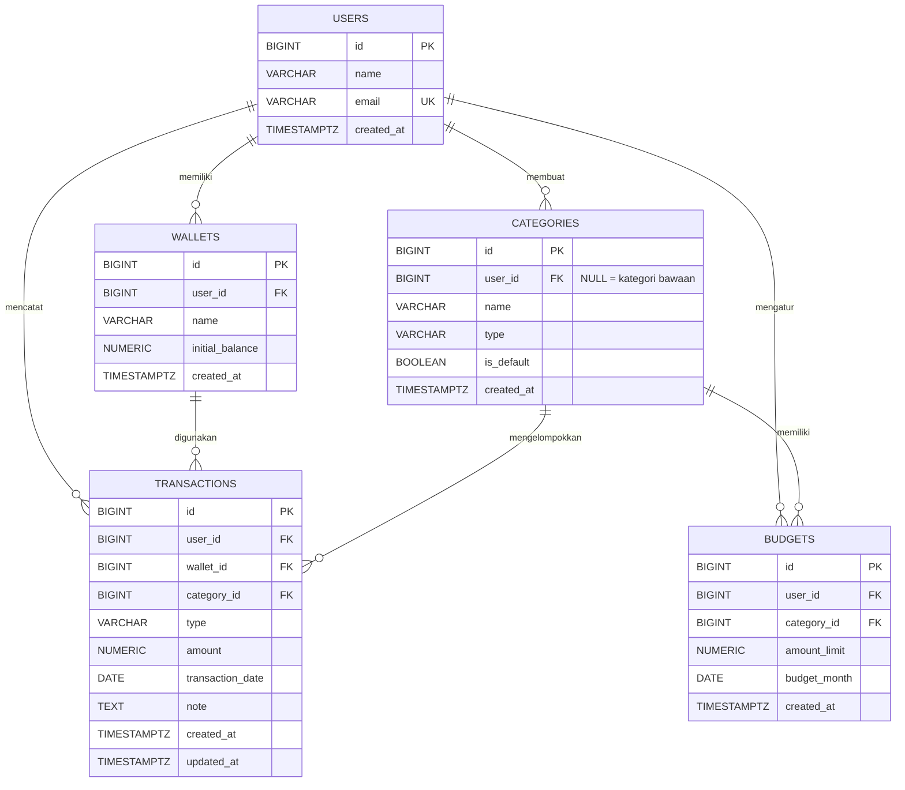

# ERD — Personal Finance Tracker

Sumber kebenaran: `database/schema.sql`.

## Aturan penghapusan (foreign key)

| Relasi | Aksi |
|---|---|
| users → wallets / categories / transactions / budgets | `CASCADE` (hapus pengguna = hapus semua datanya) |
| wallets → transactions | `RESTRICT` (dompet terpakai tidak bisa dihapus) |
| categories → transactions / budgets | `RESTRICT` (kategori terpakai tidak bisa dihapus) |

## Constraint penting

- `transactions.amount > 0`; jenis pemasukan/pengeluaran dibedakan oleh kolom `type`.
- `wallets.initial_balance >= 0`, nama dompet unik per pengguna.
- `categories`: nama + tipe unik per pengguna, dan unik juga untuk kategori bawaan (partial unique index).
- `budgets.budget_month` selalu tanggal 1; satu anggaran per (pengguna, kategori, bulan).
